<h1 align="center">kernova</h1>

<p align="center">
  <strong>Plateforme d'apprentissage informatique, entièrement statique et en français.</strong><br />
  273 cours, 1 358 leçons, des exercices corrigés, un terminal simulé, un simulateur réseau,
  du Python et du SQL exécutés réellement — sans backend, sans compte, sans base distante.
</p>

<p align="center">
  <a href="#démarrage"><strong>Lancer le projet</strong></a> ·
  <a href="#tests"><strong>Tests</strong></a> ·
  <a href="#architecture"><strong>Architecture</strong></a> ·
  <a href="#limites-connues"><strong>Limites</strong></a>
</p>

<p align="center">
  
  
  
  
  
</p>

<p align="center">
  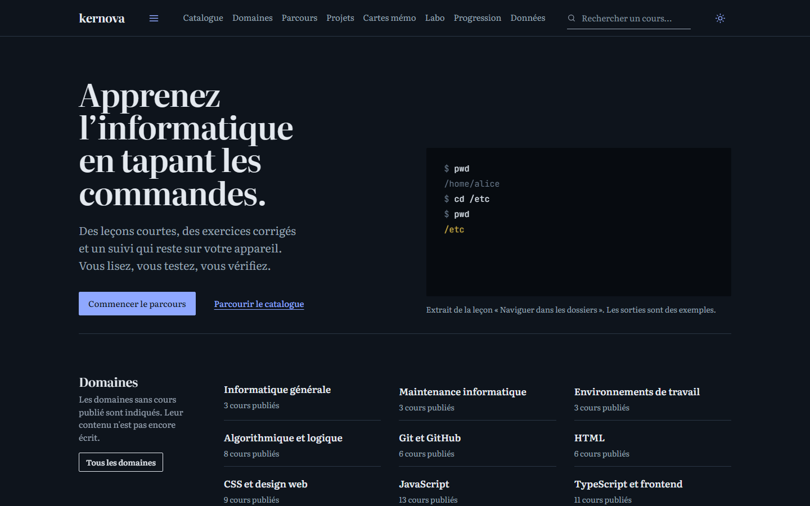
</p>

## Sommaire

- [Aperçu](#aperçu)
- [Chiffres clés](#chiffres-clés)
- [Fonctionnalités](#fonctionnalités)
- [Captures](#captures)
- [Architecture](#architecture)
- [Structure du projet](#structure-du-projet)
- [Démarrage](#démarrage)
- [Tests](#tests)
- [Déploiement](#déploiement)
- [Hors ligne](#hors-ligne)
- [Données et ajout de contenu](#données-et-ajout-de-contenu)
- [Sécurité et vie privée](#sécurité-et-vie-privée)
- [Accessibilité](#accessibilité)
- [Limites connues](#limites-connues)
- [Pistes d'amélioration](#pistes-damélioration)
- [Crédits](#crédits)

## Aperçu

kernova est un catalogue pédagogique qui couvre les fondamentaux jusqu'aux spécialisations :
informatique générale, algorithmique, développement web, Python et autres langages, backend,
bases de données, Linux, Windows, réseaux, cybersécurité, cloud, conteneurs, tests,
architecture, IA, automatisation, mobile, UX/UI, SEO, observabilité, gestion et réglementation.

Chaque cours est un parcours de plusieurs leçons. Une leçon contient des objectifs, un contenu
progressif, des exemples, un résumé en trois points, une suite logique, un exercice vérifiable
et des questions de quiz. Les cours se répondent par des prérequis et des recommandations.

Le tout fonctionne **sans serveur applicatif** : le navigateur charge des fichiers statiques et
conserve la progression dans `localStorage`. Aucune donnée ne quitte l'appareil.

## Chiffres clés

| Élément | Quantité |
| --- | --- |
| Cours | **273** |
| Modules | **321** |
| Leçons | **1 358** |
| Exercices | **1 358** |
| Questions de quiz | **2 335** |
| Domaines couverts | **34 / 34** |
| Projets guidés | **46** |
| Paquets de cartes mémo | **14** (112 cartes) |
| Fiches mémo | **12** (65 entrées) |
| Langages d'éditeurs | **5** (C, C++, Go, Java, PHP) |
| Suites de tests | **34** |

## Fonctionnalités

**Catalogue et cours**

- Catalogue filtrable par domaine, sous-domaine, niveau, technologie, langue, durée, type,
  progression et favoris, avec recherche plein texte et tri.
- Cours organisés en modules et chapitres, avec objectifs, prérequis et compétences.
- Leçons avec blocs de contenu, tableaux, code coloré, encarts d'astuce et d'avertissement.
- Arbre de compétences, prérequis et cours suivants recommandés.
- Projet pratique par cours : cahier des charges, étapes, critères, fichiers de départ et indices.

**Évaluation et progression**

- Exercices vérifiables localement : réponses acceptées, mots-clés obligatoires ou alternatives.
- Quiz de chapitre (7 types de questions) et évaluation finale par cours : 12 questions,
  une tentative, seuil de 70 %, chronomètre.
- Progression persistante : chapitres terminés, reprise, favoris, notes personnelles,
  résultats de quiz, projets cochés.
- Tableau de bord : avancement, séries, badges, temps estimé, cours en cours et terminés.
- Cartes mémo avec révision espacée et paquets personnels.
- Historique et cours récemment consultés.

**Outils interactifs**

| Outil | Réalité |
| --- | --- |
| Playground web | Exécution réelle de HTML/CSS/JS dans une iframe isolée, console capturée |
| Terminal Linux | Simulation : système de fichiers virtuel, permissions, pipes, redirections, 6 scénarios |
| Simulateur réseau | Simulation : adressage, sous-réseaux, routage, pare-feu, DNS, animation des paquets |
| Python et SQL | Exécution réelle via Pyodide 0.26.4 et sql.js 1.10.3, avec délai maximal et bouton d'arrêt |
| Éditeurs C, C++, Go, Java, PHP | Validation structurelle locale, sans compilation ni exécution |
| Fiches mémo | Recherche, catégories, copie, impression et favoris |

**Recherche et données**

- Recherche globale sur les cours, chapitres, fiches, paquets, projets et domaines.
- Export, import et réinitialisation des données locales, avec sauvegarde des données corrompues.
- Thème clair, sombre ou système, respecté au chargement.

## Captures

### Site et catalogue

<p align="center">
  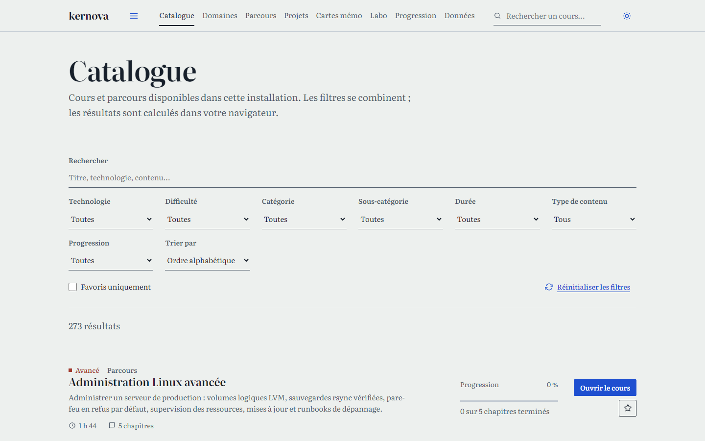
</p>

<table>
  <tr>
    <td width="50%">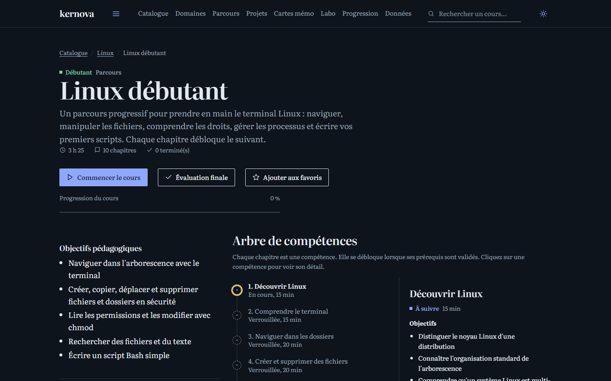</td>
    <td width="50%">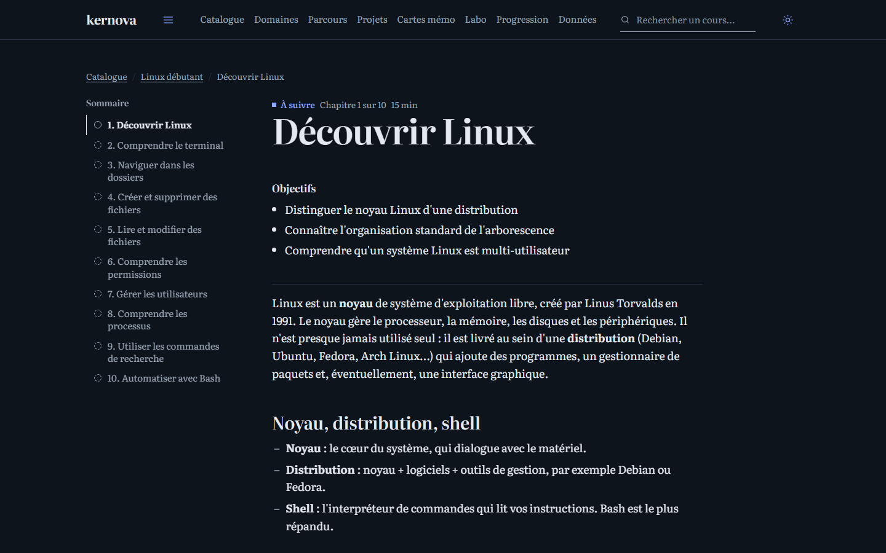</td>
  </tr>
  <tr>
    <td width="50%">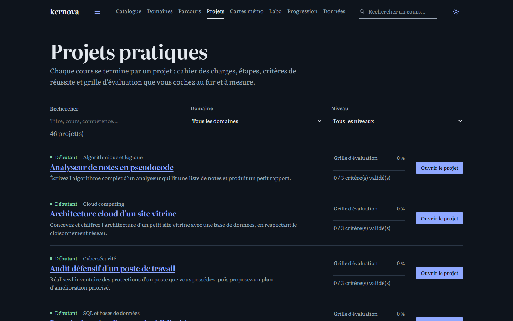</td>
    <td width="50%">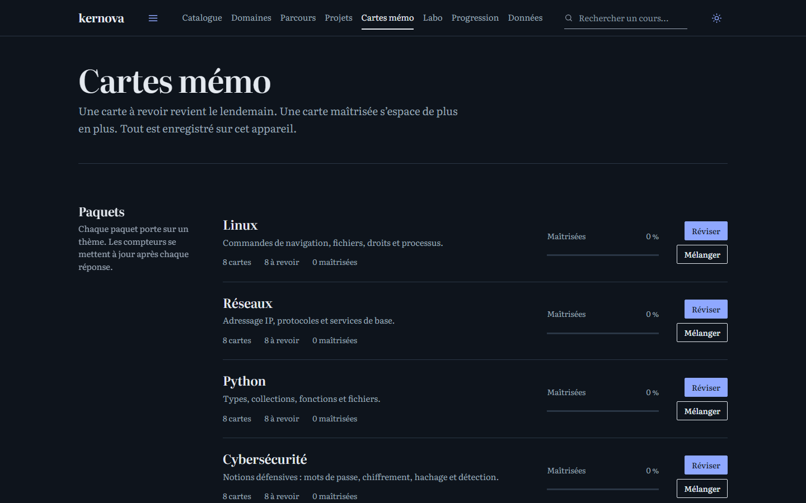</td>
  </tr>
  <tr>
    <td width="50%">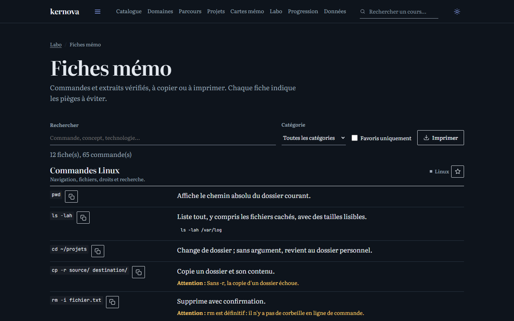</td>
    <td width="50%">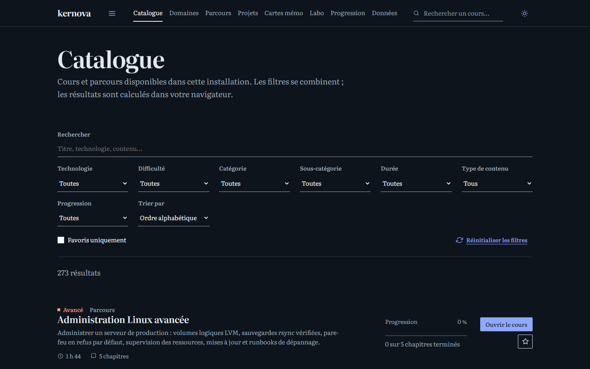</td>
  </tr>
</table>

### Outils interactifs

<table>
  <tr>
    <td width="50%">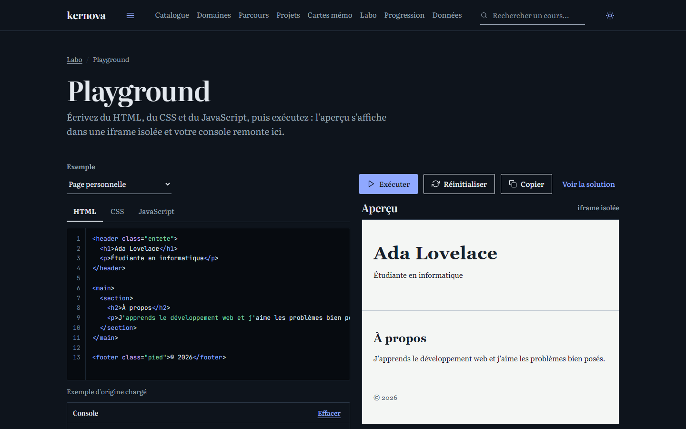</td>
    <td width="50%">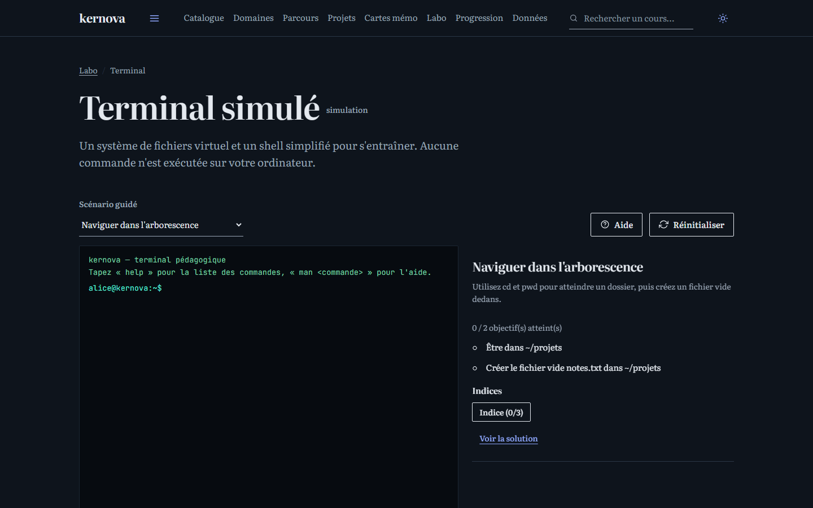</td>
  </tr>
  <tr>
    <td width="50%">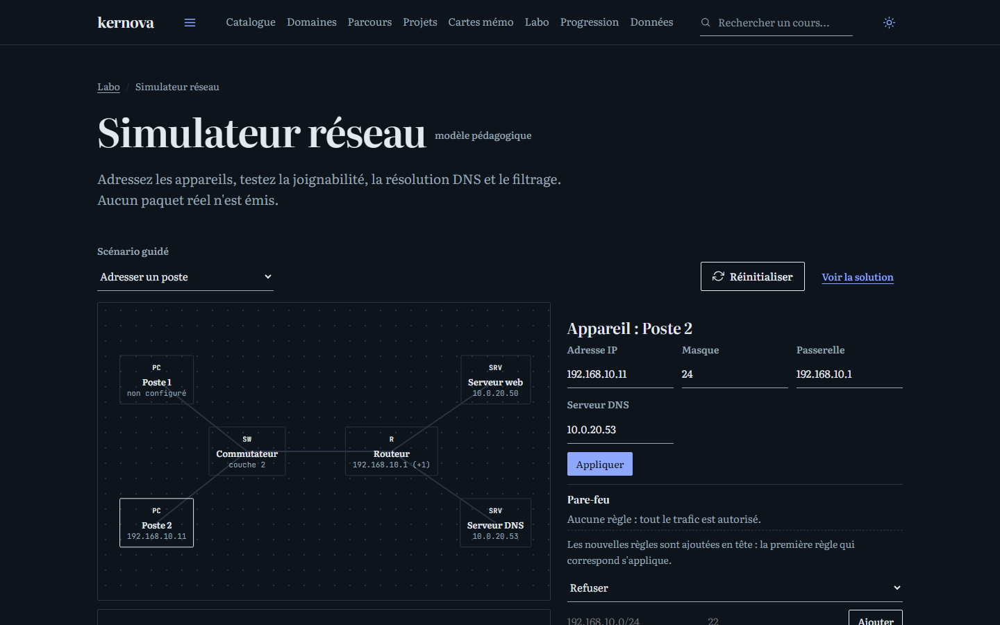</td>
    <td width="50%">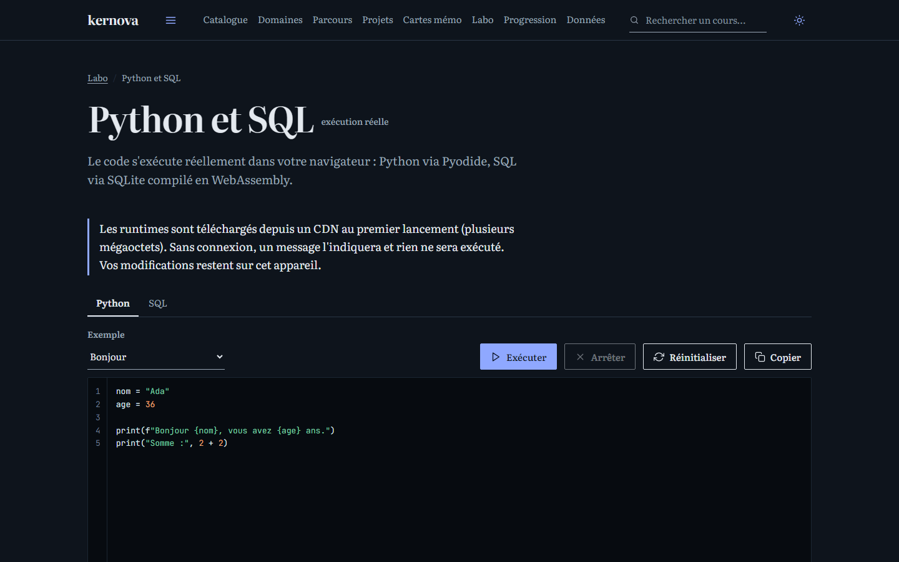</td>
  </tr>
  <tr>
    <td width="50%">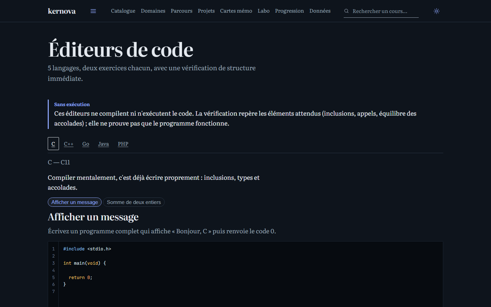</td>
    <td width="50%">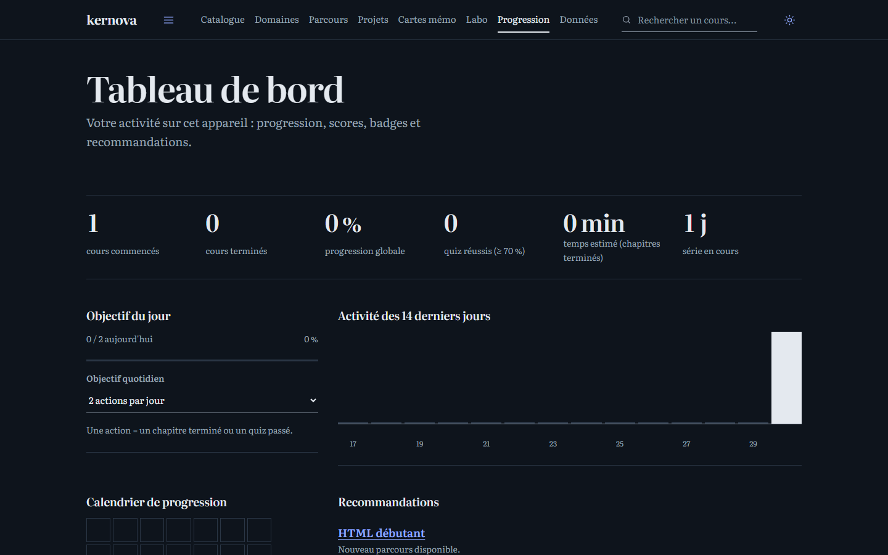</td>
  </tr>
</table>

### Mobile

<p align="center">
  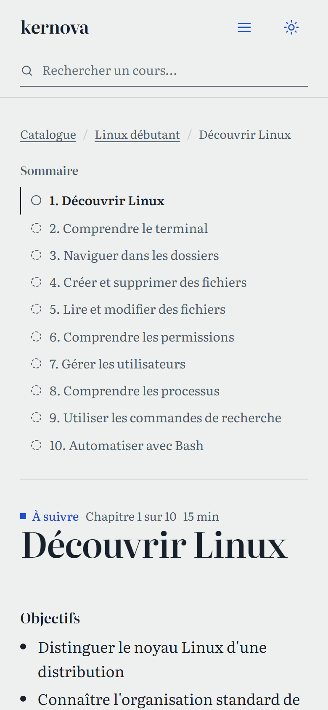
</p>

## Architecture

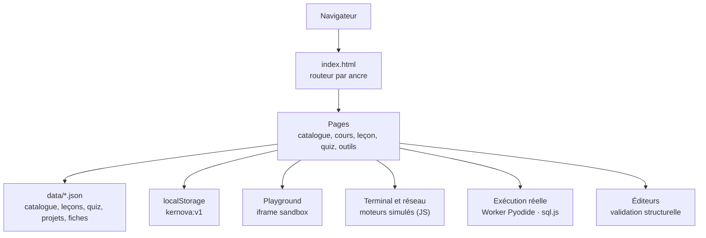

Il n'y a **aucun serveur applicatif** : le navigateur lit des fichiers JSON statiques et écrit la
progression dans `localStorage`. Le routeur utilise le hash (`#/chemin`), ce qui rend le site
compatible avec un hébergement statique sans règle de réécriture complexe.

| Couche | Rôle |
| --- | --- |
| `assets/js/core/` | Données, stockage, progression, recherche, statistiques, validation |
| `assets/js/pages/` | Une page par route |
| `assets/js/components/` | Blocs de leçon, éditeur de code, widgets |
| `assets/js/quiz/` | Logique de notation et vue du quiz |
| `assets/js/terminal/`, `assets/js/network/` | Moteurs de simulation |
| `assets/js/runtime/` | Chargement de Pyodide et sql.js |
| `data/` | Contenu pédagogique, séparé de l'affichage |

## Structure du projet

```text
kernova/
├── index.html                  shell, navigation, amorçage du thème
├── 404.html                    redirection des chemins inconnus vers le routeur
├── netlify.toml                publication statique et redirection SPA
├── .nojekyll                   empêche Jekyll d'ignorer des fichiers
├── package.json                scripts start et test, sans dépendance
├── README.md
├── assets/
│   ├── css/
│   │   ├── main.css            système de design complet
│   │   └── fonts.css           polices auto-hébergées
│   ├── fonts/                  Literata et JetBrains Mono (.woff2)
│   └── js/
│       ├── app.js              routes et câblage
│       ├── core/               dom, utils, schéma, store, données, routeur,
│       │                       ui, progression, statistiques, recherche, parcours
│       ├── components/         lesson, editor, widgets
│       ├── pages/              une page par route
│       ├── quiz/               logique et vue
│       ├── terminal/           moteur du terminal
│       ├── network/            moteur du réseau
│       └── runtime/            loader, python, worker, sql
├── data/
│   ├── catalog.json            domaines et métadonnées des cours
│   ├── lessons/                273 fichiers de cours (contenu, quiz, projet)
│   ├── exercises/              exercices Git et Python stockés séparément
│   ├── flashcards.json         paquets fournis
│   ├── flashcards-extra.json
│   ├── cheatsheets.json
│   ├── playground.json
│   ├── terminal.json
│   ├── network.json
│   ├── execution.json
│   ├── editors.json
│   ├── projects-extra.json     fichiers de départ et indices
│   ├── PLAN.md                 décisions et état du projet
│   └── BACKLOG.md              suivi de la couverture du programme
├── docs/
│   └── screenshots/            captures du README
└── tests/
    ├── lib/                    serveur statique, environnement, axe-core
    ├── run.mjs                 lanceur de toutes les suites
    ├── a11y.mjs, e2e.mjs, …    suites de bout en bout
    └── part2.mjs … part19.mjs  vérifications du catalogue par lot
```

## Démarrage

Aucun build, aucune dépendance à installer. Il faut simplement servir les fichiers en HTTP.

**Avec Node.js (recommandé)**

```bash
cd kernova
npm start
# http://127.0.0.1:8000/
```

**Sans Node.js**

```bash
python -m http.server 8000
```

N'ouvrez pas `index.html` par double-clic : les modules ES et les `fetch` de JSON échouent en
`file://`. Gardez la même adresse et le même port, car la progression est liée à l'origine.

## Tests

Les tests utilisent Chrome en mode sans interface et pilotent le vrai site.

```bash
npm test              # toutes les suites
npm test -- e2e       # une seule suite
npm test -- part12    # un lot du catalogue
```

- **34 suites** : intégrité, e2e, playground, terminal, réseau, fiches/labo, évaluation finale,
  exécution, projets, parcours, résumés, recherche, mobile, éditeurs, accessibilité,
  et parties 2 à 19 du catalogue.
- **Audit axe-core** : 10 pages × 3 thèmes (système, clair, sombre), seuil bloquant à zéro
  violation sérieuse ou critique.
- **Mobile** : 17 pages vérifiées à 390 px, sans débordement horizontal.
- Chrome est détecté automatiquement ; sinon, définissez `KERNOVA_CHROME` avec le chemin de
  l'exécutable.
- `npm start` et `npm test` utilisent le serveur statique intégré (`tests/lib/`), sans Python.

## Déploiement

**GitHub Pages**

1. Publier la racine du dépôt sur la branche `main`.
2. `.nojekyll` est déjà présent ; `404.html` renvoie les chemins inconnus vers le routeur.
3. Aucune variable d'environnement n'est nécessaire.

**Netlify**

1. Connecter le dépôt ; `netlify.toml` publie la racine et redirige vers `index.html`.
2. Aucun build à configurer.

Le site peut aussi être déposé sur Cloudflare Pages ou tout hébergeur statique.

## Hors ligne

- Toutes les leçons, le catalogue, les fiches, les cartes et les outils de simulation sont
  locaux : le site fonctionne sans connexion.
- Les polices sont auto-hébergées.
- **Exception** : l'exécution Python (Pyodide) et SQL (sql.js) charge des fichiers depuis
  `cdn.jsdelivr.net` au premier lancement. Hors ligne, ces deux outils affichent une erreur
  explicite et proposent de réessayer.
- Le service worker n'est pas utilisé : l'onglet ouvert reste fonctionnel, mais un rechargement
  hors ligne nécessite que les fichiers soient encore en cache.

## Données et ajout de contenu

Le contenu est séparé de l'affichage, ce qui permet d'ajouter un cours sans toucher au code.

**Métadonnées d'un cours (`data/catalog.json`)**

```json
{
  "id": "mon-cours",
  "title": "Mon cours",
  "domain": "python",
  "subdomain": "Langage",
  "level": "debutant-avance",
  "type": "parcours",
  "technologies": ["Python"],
  "description": "…",
  "objectives": ["…"],
  "prerequisites": ["…"],
  "prerequisiteCourses": ["python-debutant"],
  "nextCourses": ["python-intermediaire"],
  "skills": ["…"],
  "file": "mon-cours.json"
}
```

**Leçon (`data/lessons/mon-cours.json`)**

```json
{
  "courseId": "mon-cours",
  "modules": [{
    "id": "module-1",
    "title": "Module 1",
    "chapters": [{
      "id": "mc-01",
      "title": "Première leçon",
      "duration": 20,
      "objectives": ["…"],
      "content": [{ "type": "p", "text": "…" }],
      "exercise": {
        "title": "Exercice",
        "instructions": "…",
        "hints": ["…", "…"],
        "solution": "…",
        "check": { "type": "keywords", "keywords": ["…"] }
      },
      "quiz": [{ "id": "mc-01-q1", "type": "single", "question": "…", "options": ["…"], "answer": 0, "explanation": "…" }],
      "summary": ["…", "…", "…"],
      "nextStep": "Chapitre suivant : « … »."
    }]
  }]
}
```

Types de vérification : `answers` (réponses acceptées), `keywords` (tous requis), `any`
(au moins un). Les blocs de contenu gèrent `p`, `h`, `list`, `code`, `table`, `tip`, `warning`.

**Étapes**

1. Créer le fichier de leçons.
2. Ajouter le cours au catalogue avec un identifiant unique.
3. Relier les prérequis et cours suivants.
4. Lancer `npm test -- integrity` : identifiants, champs obligatoires, fichiers et liens sont
   contrôlés.
5. Vérifier une leçon dans le navigateur.

## Sécurité et vie privée

- **Aucun compte, aucun mot de passe, aucun serveur** : la progression reste dans le navigateur.
- **Aucune donnée envoyée** à un tiers par l'application ; les seuls appels réseau sont les
  fichiers Pyodide/sql.js depuis le CDN, au moment de l'exécution.
- **Aucun secret** dans le code ou les données.
- Le playground s'exécute dans une **iframe sandbox** sans accès au stockage ni au site.
- Le contenu utilisateur est inséré avec `textContent` ou échappé : pas d'injection HTML.
- L'import de données est validé et les entrées invalides sont ignorées.
- L'export/import permet de sauvegarder sa progression ; la réinitialisation est confirmée.

## Accessibilité

- Audit axe-core sur 10 pages, en thème système, clair et sombre : **0 violation sérieuse ou
  critique**.
- Contrastes vérifiés, focus visible, navigation clavier, labels associés, titres hiérarchisés.
- 17 pages testées à 390 px sans débordement horizontal.
- Les simulateurs et l'absence d'exécution réelle sont annoncés dans l'interface.

## Limites connues

- **Vérification des réponses ouvertes par mots-clés** : une bonne réponse formulée autrement
  peut être refusée ; la solution reste la référence.
- **Éditeurs C, C++, Go, Java, PHP** : validation structurelle, pas de compilation.
- **Terminal et réseau** : simulations explicitement signalées.
- **Python et SQL** : dépendent du CDN au premier lancement.
- **Volume** : les 1 324 entrées du programme sont couvertes, parfois au-delà (1 358 leçons).
  Les lots ajoutés en fin de projet sont plus concis que les premiers cours.
- **Pas de synchronisation** entre appareils : la progression est locale.
- **Pas de test formel avec lecteur d'écran** : l'audit automatique complète les tests clavier
  et mobile, il ne les remplace pas.

## Pistes d'amélioration

1. Ajouter une suite de tests avec lecteur d'écran et un audit axe sur les 273 cours.
2. Enrichir les leçons tardives (davantage de questions et d'exemples).
3. Vendre localement Pyodide et sql.js pour un fonctionnement 100 % hors ligne.
4. Ajouter un mode « révision ciblée » basé sur les erreurs de quiz.

## Crédits

- Polices **Literata** et **JetBrains Mono** (SIL Open Font License), auto-hébergées.
- **Pyodide** (MPL 2.0) pour Python dans le navigateur.
- **sql.js** (MIT) et SQLite (domaine public) pour SQL.
- **axe-core** (MPL 2.0) pour les tests d'accessibilité.
- Contenu pédagogique original, rédigé pour ce projet.

---

<p align="center"><sub>kernova — apprendre en lisant, en tapant et en vérifiant.</sub></p>

## English summary

kernova is a fully static, French-language IT learning platform: 273 courses, 1,358 lessons,
2,335 quiz questions, 46 guided projects and 34 domains, with graded exercises, flashcards,
a simulated Linux terminal and network lab, a sandboxed web playground, and real Python/SQL
execution. There is no backend and no account; progress is stored in `localStorage`. Run
`npm start` (needs Node 18+) or `python -m http.server 8000`, and `npm test` for the 34 test
suites (Chrome required).
